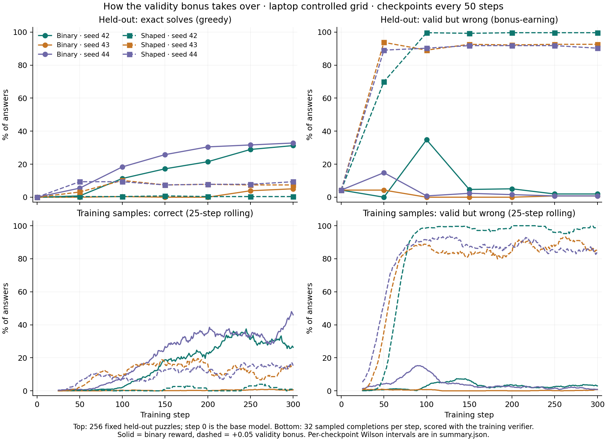

# Checkpoint trajectory: how the validity bonus takes over

Follow-up to the [laptop controlled grid](../controlled-local/README.md), pre-registered in the
[study ledger](../../../docs/study-ledger.md) before any result existed. No new training: the
step 50–300 checkpoints of all six `controlled-local-v2` runs were pulled from W&B and evaluated on
the original 256-puzzle holdout with the unchanged protocol (greedy, 256-token cap,
`declared-expression-v1`). Step 0 is the untrained base model. In addition, the 32 completions
sampled at each of the 300 training steps (57,600 in total) were re-scored with the training verifier.

## Integrity gates (all passed)

- **Reproduction.** Each step-300 checkpoint adapter is byte-identical to the published final
  adapter. Its re-evaluation reproduced the published evaluation exactly for all six runs: every one
  of the 256 completions and scores matched.
- **Training rewards.** All 57,600 recomputed training rewards equal the rewards logged during training.
- **Lineage.** Each checkpoint was logged by the matching laptop training run and holds the stated
  global step. All 37 evaluations ran from clean commits. Five earlier step-300 evaluations, started
  while untracked files were present, are tagged `superseded-dirty-tree` in W&B and excluded. Their
  results were identical.

## Held-out exact solves (of 256)

| Run | 0 | 50 | 100 | 150 | 200 | 250 | 300 |
| --- | ---: | ---: | ---: | ---: | ---: | ---: | ---: |
| Binary · 42 | 0 | 2 | 29 | 44 | 55 | 74 | **80** |
| Binary · 43 | 0 | 0 | 1 | 0 | 0 | 10 | **13** |
| Binary · 44 | 0 | 14 | 47 | 66 | 78 | 81 | **84** |
| Shaped · 42 | 0 | 1 | 1 | 2 | 1 | 1 | **1** |
| Shaped · 43 | 0 | 8 | 26 | 19 | 20 | 19 | **19** |
| Shaped · 44 | 0 | 24 | 24 | 19 | 20 | 20 | **24** |

## Held-out valid-but-wrong answers (the bonus-earning behaviour, of 256)

| Run | 0 | 50 | 100 | 150 | 200 | 250 | 300 |
| --- | ---: | ---: | ---: | ---: | ---: | ---: | ---: |
| Binary · 42 | 11 | 0 | 89 | 12 | 13 | 5 | 5 |
| Binary · 43 | 11 | 11 | 0 | 0 | 0 | 2 | 2 |
| Binary · 44 | 11 | 38 | 2 | 6 | 4 | 2 | 2 |
| Shaped · 42 | 11 | 179 | 255 | 254 | 255 | 255 | 255 |
| Shaped · 43 | 11 | 240 | 228 | 237 | 236 | 237 | 237 |
| Shaped · 44 | 11 | 228 | 231 | 235 | 235 | 235 | 231 |

Per-checkpoint Wilson intervals, truncation, mean generated tokens and full outcome categories are
in [summary.json](summary.json). Raw evaluations are in the per-run directories and in
[base.json](base.json).

## Answers to the pre-registered questions

1. **Shaped runs did not learn and then collapse. They stopped improving almost immediately.**
   By step 50, 70–94% of held-out answers were valid but wrong, and by step 100 that rose to 89–100%.
   Held-out accuracy then stayed flat for the remaining 200–250 steps: each shaped run ends within
   3 points of its best checkpoint (best: 2, 26 and 24 solves). Over the same steps, binary seeds 42
   and 44 kept improving, from 2 to 80 and from 14 to 84 solves.
2. **The bonus took over early, before binary training had made real progress.** Valid-but-wrong
   samples became the majority of training samples at step 54, 44 and 34 for shaped seeds 42, 43 and 44.
   At that point binary seeds 42 and 44 were still producing correct samples less than 10% of the time.
   Shaped outputs stayed as short as the base model's (21–40 generated tokens on average, against 40
   for the base) and were never truncated. Binary checkpoints at step 300 average 192–246 tokens.
   Seeds 43 and 44 kept solving about 15% of training samples in the last 25 steps, but held-out
   accuracy did not move.
3. **Binary seed 43 was a late start, not a plateau.** Its first correct training sample came at
   step 77, compared with steps 2 and 31 for seeds 44 and 42. Before that every reward was zero, so
   every GRPO advantage and gradient was exactly zero. Its step-50 LoRA `B` matrices are still all zero,
   and its step-50 completions are identical to the base model's on 256/256 puzzles. From step 100 to
   200 every held-out answer hit the 256-token cap. It then reached 10 and 13 solves at steps 250
   and 300, so it was still improving when the 300-step budget ended.

## Interpretation and limits

These results support the report's earlier explanation, which had rested only on the final
checkpoints: the bonus is easy to reach, and the policy settles on short valid expressions within
about 50 steps and stays there. The binary reward also passes through a
valid-but-wrong phase (seed 42 at step 100: 89/256), but because it gives that phase no credit, the
policy moves on. The binary seed variance in the main grid is largely explained by when the first
nonzero reward arrived (steps 2, 31 and 77). With zero-reward groups, GRPO makes no update at all.

This is descriptive evidence from three seeds and six checkpoints per run, without
multiplicity-adjusted tests. It does not show that a longer budget would rescue binary seed 43 or that
a different bonus size would avoid the takeover. Training-sample rates come from 32 samples per step
on changing training puzzles, so they are noisier than the fixed held-out evaluations.

W&B: [analysis run](https://wandb.ai/mohamedsobhi777/countdown-grpo/runs/qwa5nu97) ·
group `checkpoint-trajectory-v1`. Reproduce with
`PYTHONPATH=src .venv/bin/python scripts/run_checkpoint_trajectory.py --base`,
`PYTHONPATH=src .venv/bin/python scripts/analyze_checkpoint_trajectory.py fetch`, then
`... analyze`, and `python3 scripts/plot_checkpoint_trajectory.py` (system Matplotlib).
