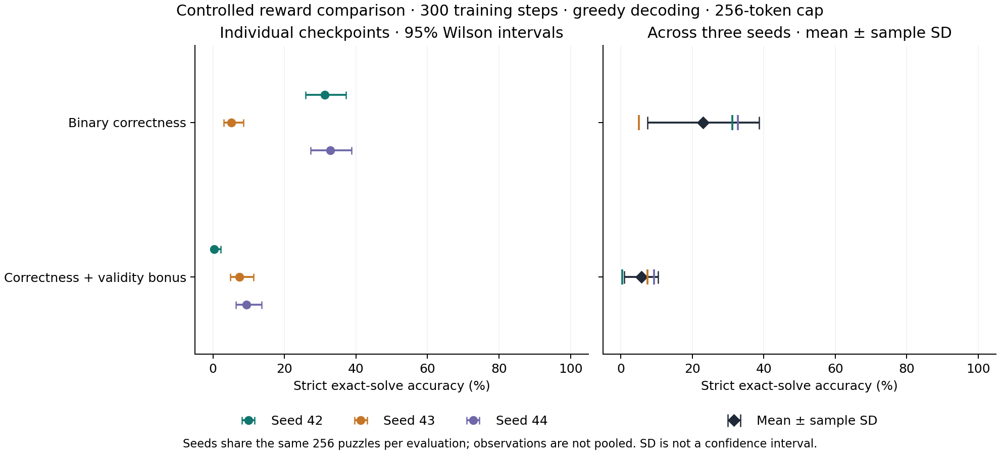

# Controlled reward study

Three training seeds share one held-out puzzle set. Do not pool 768 observations as independent puzzles. Seed standard deviations and per-checkpoint Wilson intervals describe different uncertainty. Paired exact p-values are exploratory and unadjusted. Shaped reward values are not directly comparable to binary reward values.

| Reward / seed | Solved | Accuracy | Training minutes |
| --- | ---: | ---: | ---: |
| [binary-42](https://wandb.ai/mohamedsobhi777/countdown-grpo/runs/eudebo7g) | 80/256 | 31.2% | 89.5 |
| [binary-43](https://wandb.ai/mohamedsobhi777/countdown-grpo/runs/d9it45u2) | 13/256 | 5.1% | 85.5 |
| [binary-44](https://wandb.ai/mohamedsobhi777/countdown-grpo/runs/rgyusdcc) | 84/256 | 32.8% | 89.9 |
| [shaped-42](https://wandb.ai/mohamedsobhi777/countdown-grpo/runs/ofj5pru1) | 1/256 | 0.4% | 53.4 |
| [shaped-43](https://wandb.ai/mohamedsobhi777/countdown-grpo/runs/s6q8yswn) | 19/256 | 7.4% | 46.6 |
| [shaped-44](https://wandb.ai/mohamedsobhi777/countdown-grpo/runs/11lnsy6c) | 24/256 | 9.4% | 52.4 |

Reward-group means, sample standard deviations, per-seed paired comparisons, checkpoint links, and source hashes: [summary.json](summary.json).

All six runs passed configuration, 300-step completion, score recomputation, duplicate/overlap, identical ordered puzzle-list, the selected hardware/kernel profile, and identical hardware/clean source/Python/package checks. Exported W&B provenance is archived with each run.

## Findings

| | Binary correctness | Correctness + 0.05 validity bonus |
| --- | ---: | ---: |
| Mean accuracy across seeds | **23.0%** | **5.7%** |
| Sample SD across seeds | 15.6 pp | 4.7 pp |
| Per seed (42 / 43 / 44) | 80 / 13 / 84 | 1 / 19 / 24 |
| Truncated outputs (42 / 43 / 44) | 162 / 219 / 167 | 0 / 0 / 0 |

| Seed | Shaped − binary | Gained / lost | Exact McNemar p (unadjusted) |
| --- | ---: | ---: | ---: |
| 42 | −30.86 pp | 1 / 80 | 6.8e−23 |
| 43 | +2.34 pp | 16 / 10 | 0.33 |
| 44 | −23.44 pp | 5 / 65 | 2.2e−14 |

Mean paired difference: **−17.3 pp** (sample SD 17.4 pp across seeds).

1. **The validity bonus hurt correctness in this setup.** Shaping was worse on
   two of three seeds by more than 20 points, and slightly better only on seed
   43, where binary training itself largely failed. Three seeds support the
   direction, not a precise effect size.
2. **Shaped runs converge on valid-but-wrong answers.** All three shaped
   checkpoints produce short, never-truncated expressions that use every input
   (at most one number mismatch per run), yet 231–255 of 256 have the wrong
   value. The bonus is reliably reachable, and the policy appears to settle on
   it rather than on solving; the mechanism is suggested by these outcomes,
   not causally established.
3. **Binary reward is high-variance across seeds.** Seeds 42 and 44 reach
   31–33%, matching the original 33.2% pilot, while seed 43 reaches 5.1% with
   mostly invalid or number-mismatched expressions. One run is not enough to
   characterize this recipe.

These are laptop runs (RTX 4090 Laptop GPU, reference kernels) and are not
pooled with the archived Colab/L4 controlled runs, whose only completed pair points
the same way (seed 42: binary 68 vs shaped 26).
